<p align="center">
  
  
  
  
  
  
  
  
  
  
</p>

# 💊 PharmaChain: Clone-Resistant Unit-Level Drug Traceability (v3)

### Two-part labels · case → carton → pack aggregation · multiproof dispensing · signed multi-sensor MKT cold chain · multisig-governed QBFT consortium · public checkpoints · zero-knowledge dispensing

> Every medicine pack gets a **visible QR** that anyone can verify and a **hidden scratch-off code** that is needed to dispense it. A photocopied label can therefore never be sold, even if the copy reaches a pharmacy before the genuine pack. A whole lot is committed on-chain as one Merkle root over a case → carton → pack hierarchy. The ledger runs on a self-built 4-validator Hyperledger Besu QBFT network, whose validator set lives in a contract placed in the genesis block and is governed by a regulator multisig.

📄 **Research write-up** (novelty, threat model, all experiments): [docs/RESEARCH.md](docs/RESEARCH.md) · **Project report**: [project_report.md](project_report.md)

---

## 🔑 Key Features

| Feature | What it does |
|---|---|
| 🏷️ **Two-part labels** | A visible QR (anyone can check) plus a hidden scratch code (needed to dispense). A copy arriving first is rejected and recorded as evidence, and the genuine pack still dispenses. |
| 📦 **Case → carton → pack hierarchy** | One 32-byte root per lot. A distributor accepts a 1,152-pack shipment with **3 case scans**, and the contract proves the scans cover the shipment exactly. |
| ⚡ **Carton multiproof dispensing** | Many packs in one transaction: 9,033 gas per pack for a 32-pack carton (**−87.5%**). |
| 🚫 **Evidence, not reverts** | Forged or copied labels, clones (leaked codes) and diverted packs are recorded on-chain. |
| ↩️ **Returns** | An unopened pack can be restocked after regulator approval. |
| 🌡️ **Byzantine-tolerant cold chain** | 3 device-signed sensors must agree (2 of 3), and breaches are judged by on-chain **Mean Kinetic Temperature**. 0 false quarantines and 0 missed breaches, versus 2 and 1 for a single-sensor rule. |
| 🏛️ **Multisig governance** | 2 of 3 regulator officers are needed for recalls, quarantine releases and **QBFT validator changes**. |
| ⛓️ **Own consortium chain** | 4 Besu validators, QBFT, a hand-built genesis block (Cancun, ValidatorSet contract in `alloc`), node allow-list, f = 1 fault tolerance. |
| 🌍 **Public checkpoints** | Consortium block hashes are anchored on a public chain (Polygon Amoy or a local stand-in). Anyone can audit, and a rewritten history fails. |
| 🕶️ **Zero-knowledge private lots** | A Groth16 proof in the browser shows the pack belongs to the lot and the pharmacy's shipment, with a nullifier against double dispensing. Which pack was sold stays hidden. |
| 📍 **Geo analytics** | City-level consumer scans flag **impossible travel** and **out-of-region sales**. |
| 🔍 **Ledger explorer** | Live blocks, validator mesh and proposer share, genesis decoding, checkpoints, decoded transactions and events, integrity check. |

---

## 📸 Screenshots

All captured from the running system on the 4-validator Besu network.

| | |
|---|---|
| 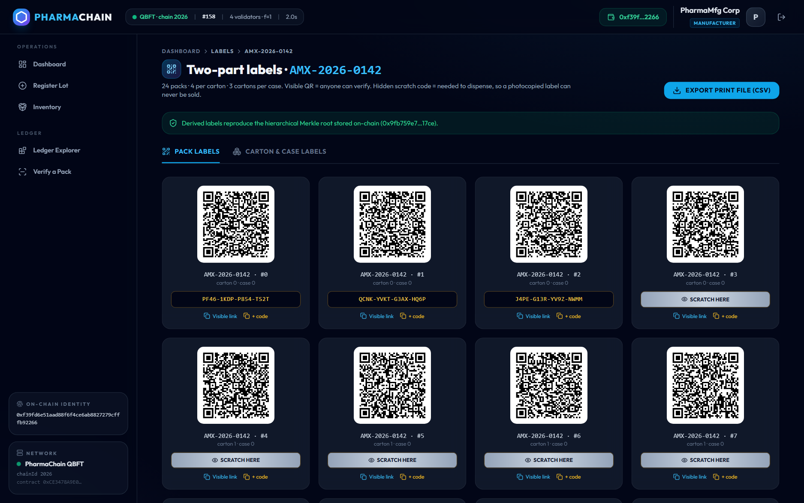 **Two-part labels**: visible QR plus scratch-off code | 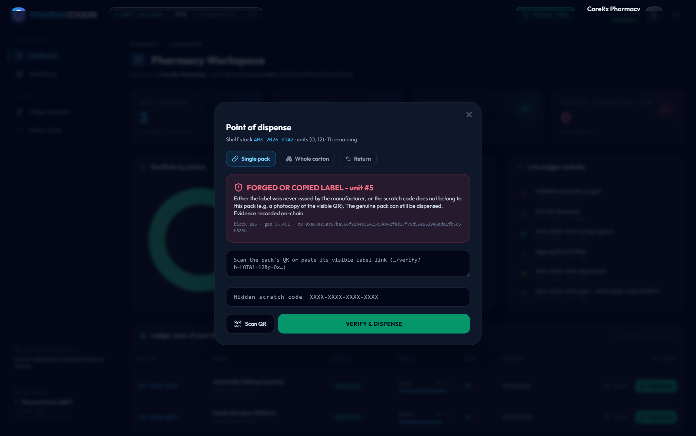 **A photocopied label, presented first, is rejected** |
| 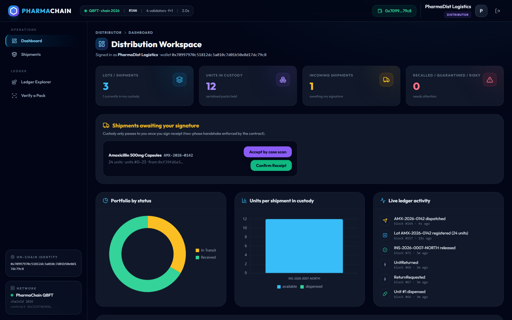 **Accept by case scan** | 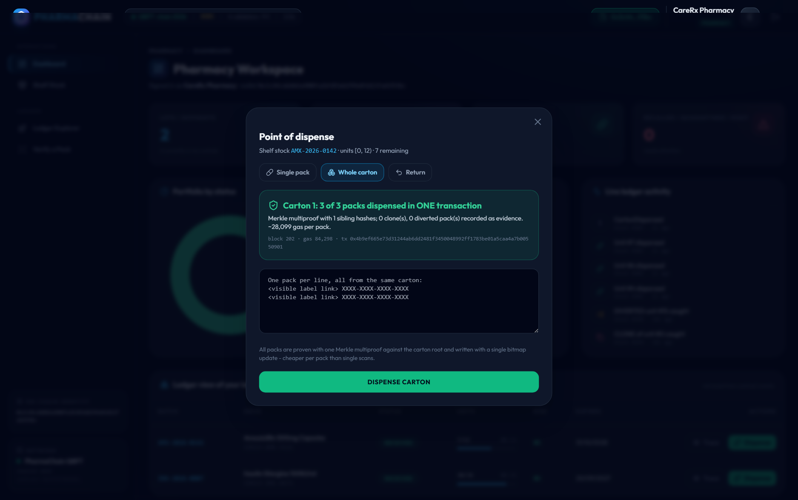 **A whole carton in one multiproof transaction** |
| 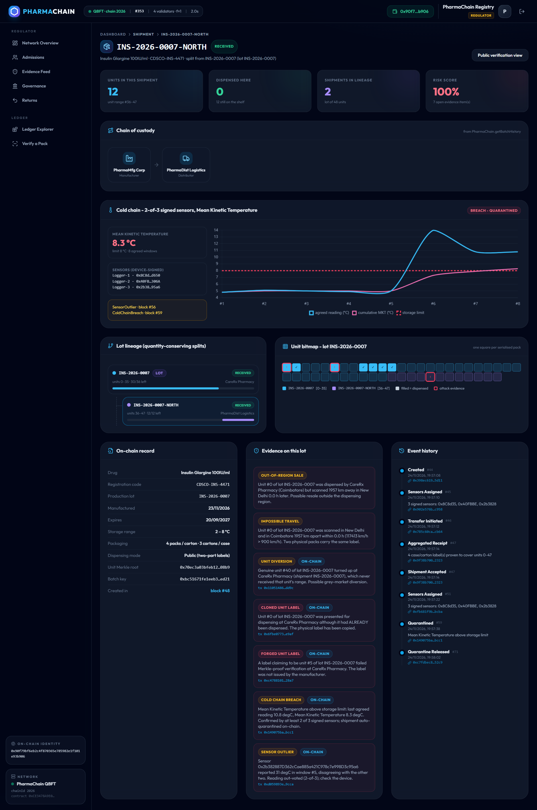 **Cold chain**: signed sensors, MKT crosses the limit, out-voted outlier |  **Zero-knowledge private dispense**, proven in the browser |
| 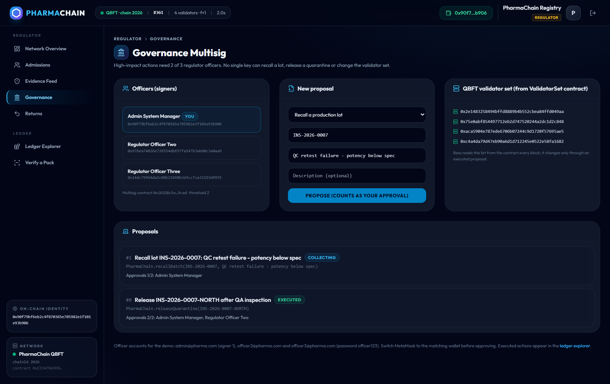 **Governance multisig**: recall proposal at 1 of 2 | 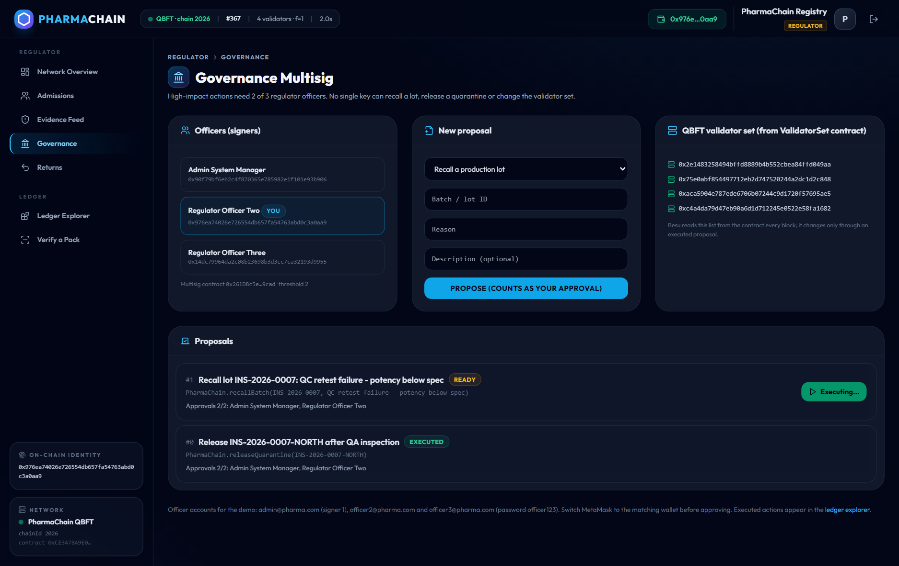 **Approved by a second officer and executed** |
| 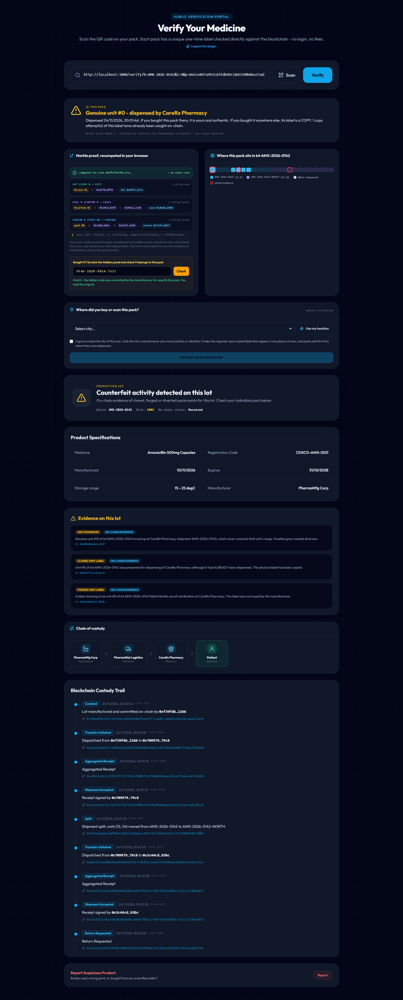 **Consumer verification**: Merkle path pack → carton → case → lot | 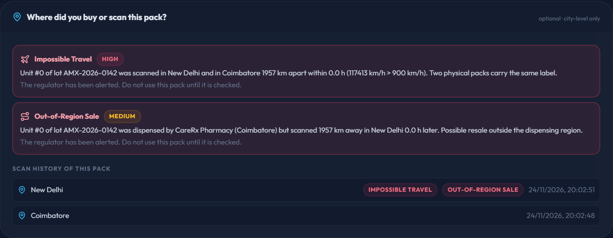 **Impossible-travel flag** |
| 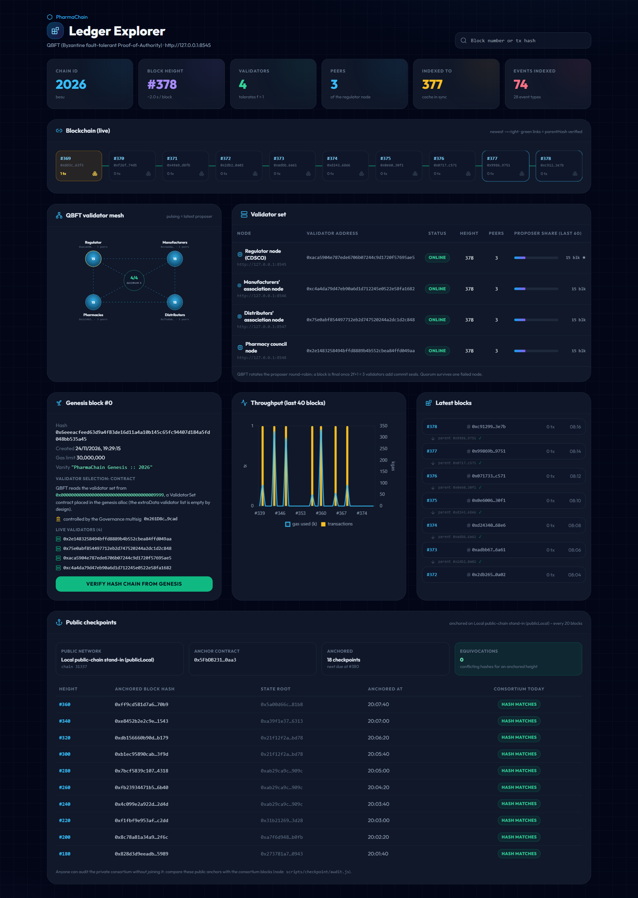 **Ledger explorer** | 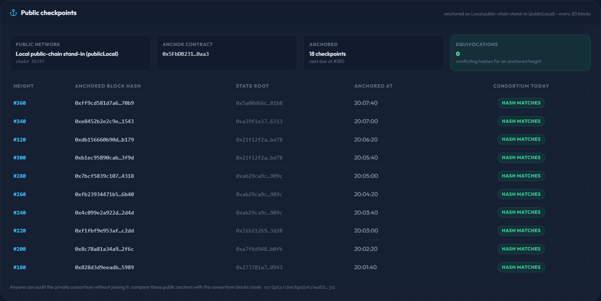 **Public checkpoints** |
| 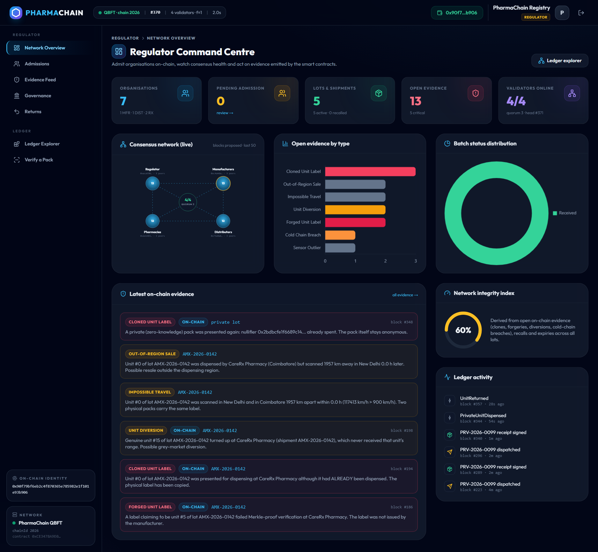 **Regulator command centre** | 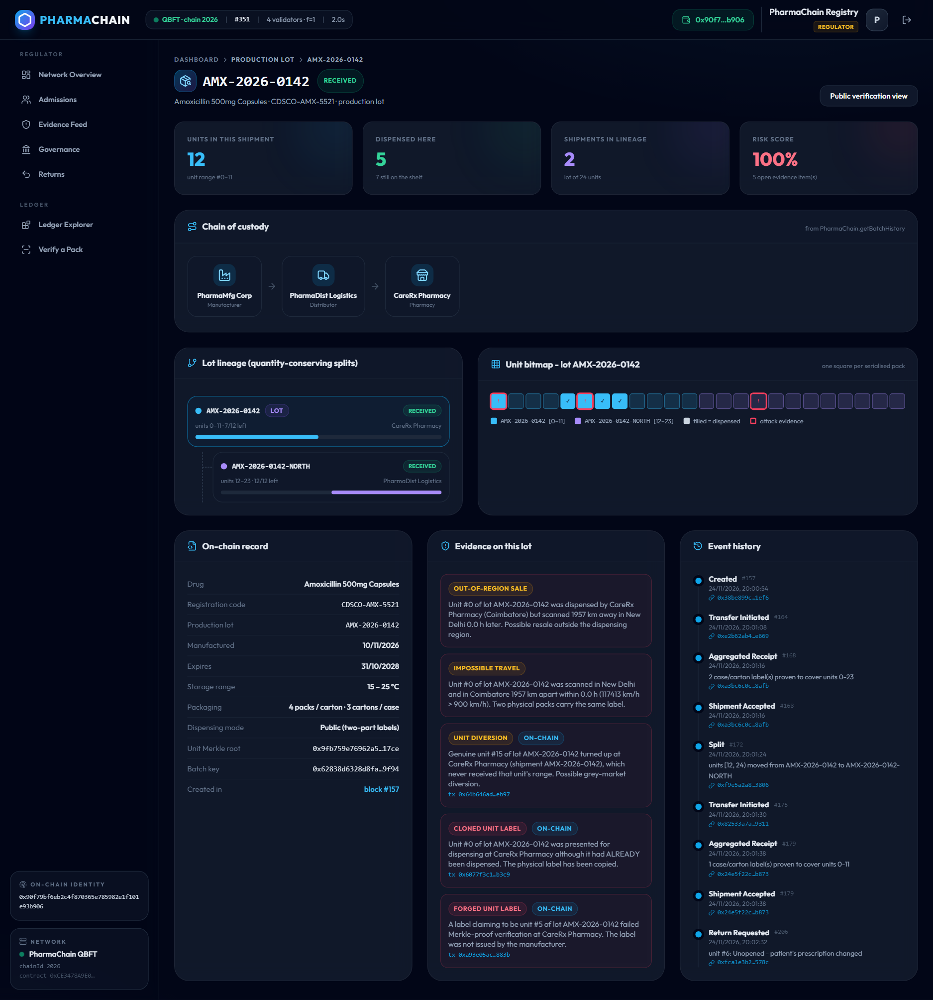 **Batch trace**: custody, lineage, unit bitmap |

All 43 figures are in [`Images/screenshots/`](Images/screenshots/) and described in the [project report](project_report.md#14-screenshots). The v1 screenshots are in [`Images/v1-archive/`](Images/v1-archive/).

---

## 🏗️ Architecture

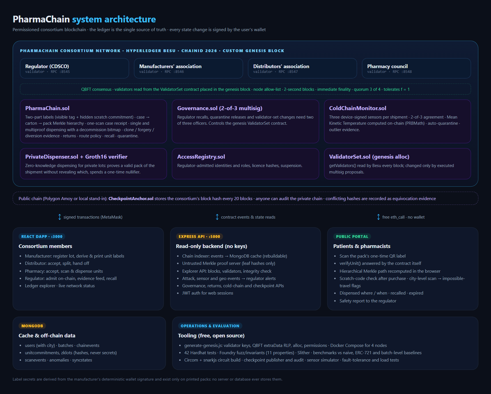

**Consensus: QBFT.** Hyperledger Besu's Byzantine-fault-tolerant Proof-of-Authority protocol.
- The proposer rotates round-robin; each block goes through pre-prepare → prepare → commit.
- A block is final with 3 of 4 commit seals, so there are no forks.
- It tolerates 1 faulty validator and halts safely with 2 down.
- Validators are read every block from the `ValidatorSet` contract that the genesis block places at `0x…9999`.

---

## ⚡ Quick Start

**Prerequisites:** Node.js 18+, MongoDB, Docker Desktop, MetaMask (all free).

```powershell
# install once
cd blockchain; npm install; cd ..ackend; npm install; cd ..rontend; npm install; cd ..
cd blockchain; npm run compile; npm run network:genesis

# Terminal 1: start the chain (4 validators + public-chain stand-in, all in Docker) and deploy
cd blockchain
npm run network:up             # starts / resumes everything - existing data is kept
npm run deploy:all             # first time: deploys core + ZK + checkpoint anchor; later: safe no-op
npm run demo:besu              # optional demo data

# Terminal 2: backend (API + indexer + checkpoint publisher)
cd backend;  npm run dev
# Terminal 3: frontend (also reachable from phones on the same Wi-Fi)
cd frontend; npm run dev
```

**Your data is persistent.** Blockchain state lives in Docker volumes and MongoDB:
- `npm run network:stop` / `network:start` (or `network:down`) pause and resume without losing anything;
- `npm run deploy:all` never replaces live contracts.

Only two commands start over, and only on purpose:
- `npm run network:reset` wipes the chain;
- `npm run deploy:fresh` deploys new, empty contracts.

Even then, the old off-chain cache is archived in MongoDB (`archive_<time>_*` collections).

**Phones:** the frontend prints `PharmaChain dApp for phones on the same network: http://<your-ip>:3000`. QR
labels encode that address, so any phone on the same Wi-Fi can scan a pack and see its verification. Use
the phone's normal camera app; the in-page "Scan" button needs HTTPS on phones.

MetaMask: the app adds and switches to **PharmaChain QBFT** (chain ID 2026, RPC `http://127.0.0.1:8545`).
If MetaMask refuses, a red banner gives one-click and manual instructions. After resetting the chain, use
MetaMask → Settings → Advanced → **Clear activity tab data**.

### 🔐 Test accounts

These are the public Hardhat dev keys. Never use them on a public network.

| Login | Password | Role | Private key |
|---|---|---|---|
| manufacturer@pharma.com | manufacturer123 | Manufacturer | `0xac0974bec39a17e36ba4a6b4d238ff944bacb478cbed5efcae784d7bf4f2ff80` |
| distributor@pharma.com | distributor123 | Distributor | `0x59c6995e998f97a5a0044966f0945389dc9e86dae88c7a8412f4603b6b78690d` |
| pharmacy@pharma.com | pharmacy123 | Pharmacy | `0x5de4111afa1a4b94908f83103eb1f1706367c2e68ca870fc3fb9a804cdab365a` |
| admin@pharma.com | admin123 | Regulator, governance signer 1 | `0x7c852118294e51e653712a81e05800f419141751be58f605c371e15141b007a6` |
| officer2@pharma.com | officer123 | Governance signer 2 | `0x92db14e403b83dfe3df233f83dfa3a0d7096f21ca9b0d6d6b8d88b2b4ec1564e` |
| officer3@pharma.com | officer123 | Governance signer 3 | `0x4bbbf85ce3377467afe5d46f804f221813b2bb87f24d81f60f1fcdbf7cbf4356` |

---

## 🧪 Tests, Verification and Experiments

```powershell
cd blockchain
npm test               # 42 Hardhat tests (core, ZK, checkpoints)
npm run fuzz           # Foundry fuzz + invariants via Docker (11 properties)
npm run slither        # static analysis (report: security/slither-report.md)
npm run benchmark      # E1-E3, E6 vs naive, ERC-721 and batch-level baselines
npm run bench:zk       # E7 zero-knowledge
npm run bench:load     # E4 throughput/latency on Besu
npm run bench:fault    # E5 stop validators: continues at 3/4, halts safely at 2/4
npm run checkpoint:audit
npm run sensor:sim     # with BATCH_ID=<shipment> PROFILE=normal|spike|sustained|freeze|faulty|malicious
node scripts/network/validator-vote.js list|add|remove 0x…   # validator change via the multisig
```

| Headline result | Value |
|---|---|
| Lot registration, 10,000 packs | **380k gas, 1 tx**, vs 250.6 M (ERC-721, 40 tx): **659× less** |
| Carton dispense, 32 packs | **9,033 gas per pack**, vs 72,248 single (−87.5%) |
| Receiving 1,152 packs | **3 case scans**, 110k gas |
| Clone attack, copies presented first | two-part labels: **30/30 copies caught, 0/10 genuine wrongly flagged**; ERC-721 or one-part: 7/10 genuine wrongly flagged |
| Cold chain | **0 false quarantines, 0 missed breaches**, vs 2 and 1 for a single-sensor rule |
| ZK private dispense | about 1.3 s proving, 326k gas |
| Verification | 42 tests; 11 fuzz/invariant properties; Slither: 0 confirmed vulnerabilities |

---

## 📡 Main API Endpoints

| Area | Endpoints |
|---|---|
| Auth | `POST /api/auth/register` (with city), `POST /api/auth/login`, `GET /api/auth/partners` |
| Batches | `GET /api/batches`, `/:id`, `/:id/lineage`, `/:id/units/:i` (hierarchical proof + commitment), `/:id/aggregation`, `/:id/coldchain`; `POST /:id/units`, `/:id/carton-proof`, `/:id/verify`, `/:id/report` |
| Regulator | `GET /api/admin/users`, `/returns`, `/anomalies`, `/stats`; `GET /api/governance/proposals` |
| ZK | `POST /api/zk/:id/leaves`, `GET /api/zk/:id/path/:i`, `/api/zk/status` |
| Geo | `POST /api/scans`, `GET /api/scans/:id/:i` |
| Checkpoints | `GET /api/checkpoints` |
| Explorer | `GET /api/chain/overview`, `/blocks`, `/blocks/:n`, `/tx/:hash`, `/validators`, `/stats`, `/integrity`, `/events` |

State changes are MetaMask-signed contract transactions; the backend holds no keys.

---

## 📂 Project Structure

```
blockchain/  contracts/ (PharmaChain, AccessRegistry, Governance, ValidatorSet, ColdChainMonitor,
                         zk/PrivateDispenser + Groth16Verifier, checkpoint/CheckpointAnchor, benchmark/ baselines)
             circuits/ (circom)  lib/unitMerkle.js  scripts/ (deploy, demo, sensors, benchmark, network/, zk/, checkpoint/)
             test/ (42 tests)  forge-test/ (Foundry)  security/ (Slither, Foundry reports)  benchmark-results/
network/     docker-compose.yml (4 Besu validators; genesis + keys generated)
backend/     src/services/chainIndexer.js, routes/, models/
frontend/    src/pages, components, utils; public/zk (prover files)
docs/        RESEARCH.md
```

---

## 🤝 Contributing

Contributions are welcome! Feel free to:

1. Fork the repository
2. Create a feature branch (`git checkout -b feature/amazing-feature`)
3. Commit changes (`git commit -m 'Add amazing feature'`)
4. Push to branch (`git push origin feature/amazing-feature`)
5. Open a Pull Request

---

## 📜 License

This project is licensed under the **MIT License** — see the [LICENSE](LICENSE) file for details.

---

## 🙏 Acknowledgments

- [Ethereum Foundation](https://ethereum.org/) — Blockchain platform
- [Hardhat](https://hardhat.org/) — Development environment
- [OpenZeppelin](https://openzeppelin.com/) — Smart contract security
- [Hyperledger Besu](https://besu.hyperledger.org/) — QBFT consortium client
- [iden3 circom / snarkjs](https://iden3.io/) — zero-knowledge proofs
- [PRBMath](https://github.com/PaulRBerg/prb-math) — fixed-point math for MKT
- [Foundry](https://getfoundry.sh/) and [Slither](https://github.com/crytic/slither) — verification
- [React.js](https://react.dev/) — Frontend framework
- [MetaMask](https://metamask.io/) — Web3 wallet

---

<p align="center">
  <strong>⭐ If you found this project useful, please give it a star!</strong>
</p>

<!-- 
SEO Keywords: blockchain pharmaceutical supply chain, medicine tracking blockchain, 
drug counterfeit detection, QR code medicine verification, ethereum supply chain, 
solidity smart contract supply chain, pharma blockchain dapp, 
pharmaceutical traceability system, anti-counterfeit medicine blockchain,
react node mongodb blockchain project, hardhat smart contract project,
decentralized pharmaceutical tracking, medicine authenticity verification,
blockchain drug tracking system, supply chain management ethereum
-->
