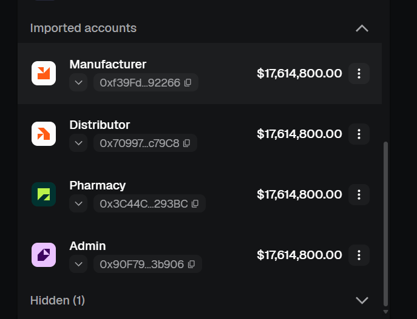
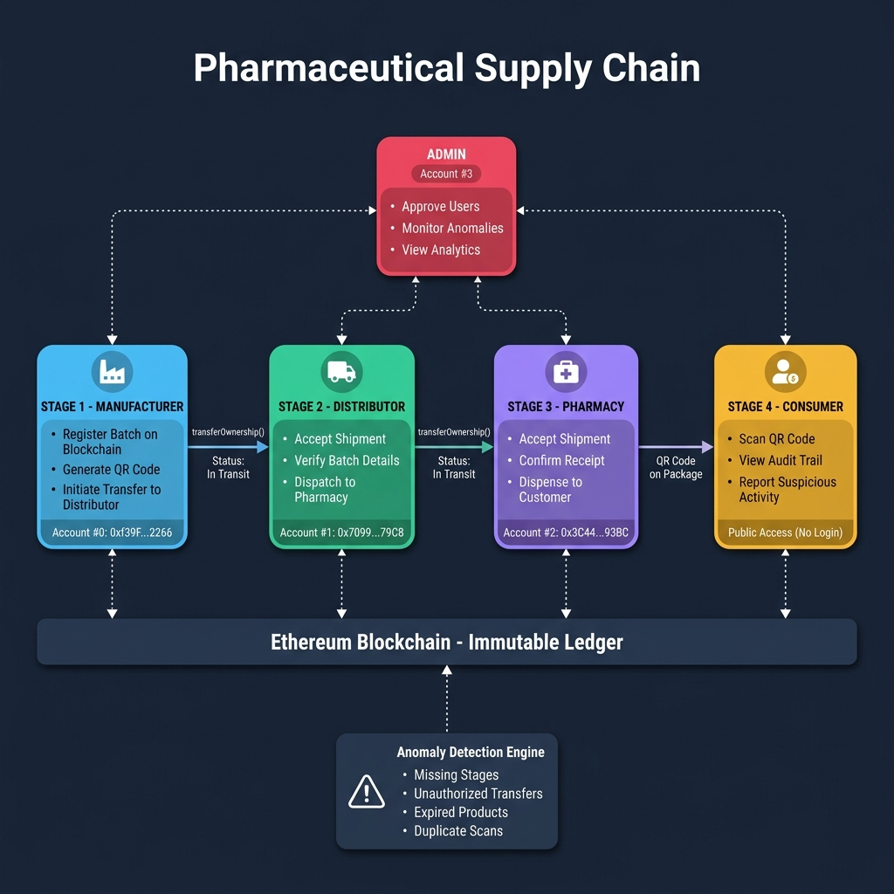

<p align="center">
  
  
  
  
  
  
  
  
</p>

# 💊 PharmaChain — Blockchain-Based Pharmaceutical Supply Chain Management System

### Secure Drug Tracking with QR Verification & Counterfeit Detection using Ethereum Smart Contracts

> A full-stack decentralized application (DApp) that tracks pharmaceutical products from **Manufacturer → Distributor → Pharmacy → Consumer** on the Ethereum blockchain. Consumers can scan a **QR code** to instantly verify medicine authenticity. An **Anomaly Detection Engine** automatically flags counterfeit indicators like skipped supply chain stages, unauthorized transfers, and expired product movements.

---

## 🔑 Key Features

| Feature | Description |
|---|---|
| 🔗 **Blockchain Tracking** | Every batch event recorded immutably on Ethereum via Solidity smart contracts |
| 📱 **QR Code Verification** | Consumers scan QR codes to verify medicine authenticity — no login required |
| 🛡️ **Counterfeit Detection** | Automated anomaly engine flags expired products, skipped stages & unauthorized transfers |
| 👥 **Role-Based Access** | Dedicated dashboards for Manufacturer, Distributor, Pharmacy & Admin |
| 🦊 **MetaMask Integration** | Transaction signing via MetaMask with automatic Hardhat network switching |
| 📊 **Admin Analytics** | System statistics, user approval workflow & anomaly monitoring dashboard |
| 🔐 **JWT Authentication** | Secure login with bcrypt password hashing & role-based route protection |
| 📦 **Batch Lifecycle** | Full status tracking: Manufactured → In Transit → Received → Recalled |

---

## 📸 Screenshots

### Environment Setup

<details>
<summary>🖥️ Click to expand setup screenshots</summary>

#### Hardhat Local Blockchain Node
Starting the local EVM node with 20 pre-funded test accounts, each with 10,000 ETH.


#### Pre-funded Test Accounts


#### Smart Contract Deployment


#### MongoDB Running


#### Backend API Server


#### Frontend Dev Server


</details>

---

### MetaMask Configuration

Four Hardhat test accounts imported into MetaMask:



Manufacturer wallet connected to the application:


---

### 🏭 Manufacturer Workflow

**Login → Create Batch → Dispatch to Distributor**


---

### 🚛 Distributor Workflow

**Receive Batch → Accept Shipment → Dispatch to Pharmacy**


---

### 💊 Pharmacy Workflow

**Receive Shipment → Confirm Receipt**


---

### ✅ Consumer Verification

**Public portal — Scan QR or enter Batch ID to verify authenticity**


---

## 🏗️ System Architecture


### Supply Chain Workflow



```
Manufacturer ──► Distributor ──► Pharmacy ──► Consumer
     │                │              │            │
     │ registerBatch  │ acceptShip.  │ acceptShip. │ verifyBatch
     │ transferOwner  │ transferOwn. │             │ (QR Scan)
     ▼                ▼              ▼             ▼
┌──────────────────────────────────────────────────────┐
│           ETHEREUM BLOCKCHAIN (Immutable)             │
└──────────────────────────────────────────────────────┘
```

---

## 🛠️ Tech Stack

### Frontend
| Technology | Purpose |
|---|---|
| React.js 18 | UI Components |
| Vite 5 | Build Tool |
| Tailwind CSS 3 | Styling |
| ethers.js 6 | Blockchain Interaction |
| Chart.js | Dashboard Analytics |
| qrcode / html5-qrcode | QR Generation & Scanning |
| Axios | HTTP Client |
| React Router 6 | Client-side Routing |

### Backend
| Technology | Purpose |
|---|---|
| Node.js 18+ | Runtime |
| Express.js 4 | REST API |
| MongoDB + Mongoose | Database |
| bcryptjs | Password Hashing |
| jsonwebtoken | JWT Auth |
| Nodemailer | Email Notifications |

### Blockchain
| Technology | Purpose |
|---|---|
| Solidity 0.8.24 | Smart Contracts |
| Hardhat 2.22 | Development Framework |
| OpenZeppelin | Security Libraries |
| MetaMask | Wallet & Signing |

---

## ⚡ Quick Start

### Prerequisites

- **Node.js** v18+ & npm
- **MongoDB** (local or Atlas)
- **MetaMask** browser extension

### 1️⃣ Clone the Repository

```bash
git clone https://github.com/YOUR_USERNAME/pharmachain-blockchain-supply-chain.git
cd pharmachain-blockchain-supply-chain
```

### 2️⃣ Start Blockchain (Terminal 1)

```bash
cd blockchain
npm install
npx hardhat node
```

### 3️⃣ Deploy Smart Contract (Terminal 2)

```bash
cd blockchain
npx hardhat run scripts/deploy.js --network localhost
```

### 4️⃣ Start Backend (Terminal 3)

```bash
cd backend
npm install
npm run dev
```

### 5️⃣ Start Frontend (Terminal 4)

```bash
cd frontend
npm install
npm run dev
```

### 6️⃣ Configure MetaMask

1. Open MetaMask → **Add Network**
2. Network Name: `Hardhat Local`
3. RPC URL: `http://127.0.0.1:8545`
4. Chain ID: `31337`
5. Currency: `ETH`
6. Import test accounts using private keys below

---

## 🔐 Test Accounts

The system auto-seeds these accounts on startup:

| Role | Email | Password | Private Key |
|---|---|---|---|
| **Manufacturer** | manufacturer@pharma.com | manufacturer123 | `0xac0974bec39a17e36ba4a6b4d238ff944bacb478cbed5efcae784d7bf4f2ff80` |
| **Distributor** | distributor@pharma.com | distributor123 | `0x59c6995e998f97a5a0044966f0945389dc9e86dae88c7a8412f4603b6b78690d` |
| **Pharmacy** | pharmacy@pharma.com | pharmacy123 | `0x5de4111afa1a4b94908f83103eb1f1706367c2e68ca870fc3fb9a804cdab365a` |
| **Admin** | admin@pharma.com | admin123 | `0x7c852118294e51e653712a81e05800f419141751be58f605c371e15141b007a6` |

> ⚠️ These are **Hardhat development keys only**. Never use them on mainnet!

---

## 📡 API Endpoints

| Method | Endpoint | Access | Description |
|---|---|---|---|
| POST | `/api/auth/register` | Public | Register user |
| POST | `/api/auth/login` | Public | Login & get JWT |
| GET | `/api/auth/me` | Private | Current profile |
| GET | `/api/auth/partners` | Private | List partners |
| POST | `/api/batches` | Manufacturer | Create batch |
| GET | `/api/batches` | Protected | List batches |
| GET | `/api/batches/:id` | Protected | Batch details |
| POST | `/api/batches/:id/verify` | **Public** | Verify product |
| POST | `/api/batches/:id/report` | **Public** | Report suspicious |
| POST | `/api/transfers/initiate` | Protected | Transfer batch |
| POST | `/api/transfers/accept` | Protected | Accept shipment |
| POST | `/api/transfers/recall` | Protected | Recall batch |
| GET | `/api/admin/users` | Admin | List users |
| PUT | `/api/admin/users/:id/approve` | Admin | Approve user |
| GET | `/api/admin/anomalies` | Admin | List anomalies |
| GET | `/api/admin/stats` | Admin | System stats |

---

## 🛡️ Anomaly Detection

The system automatically detects counterfeit indicators:

| Rule | Trigger | Risk Score | Severity |
|---|---|---|---|
| **Expired Product** | Active batch past expiry date | +40 | High |
| **Missing Stage** | Manufacturer → Pharmacy (skipped Distributor) | +50 | Critical |
| **Unauthorized Transfer** | Pharmacy initiated a transfer | +45 | High |
| **Duplicate QR Scans** | Batch scanned >50 times | +30 | Medium |

**Classification:** 0-30 = ✅ Genuine | 31-69 = ⚠️ Suspicious | 70-100 = 🚨 Critical

---

## 📂 Project Structure

```
├── blockchain/
│   ├── contracts/SupplyChain.sol     # Solidity smart contract
│   ├── scripts/deploy.js            # Auto-deploy script
│   └── hardhat.config.js
│
├── backend/
│   └── src/
│       ├── config/db.js              # MongoDB connection
│       ├── middleware/auth.js        # JWT + RBAC
│       ├── models/                   # User, Batch, Anomaly schemas
│       ├── routes/                   # auth, batches, transfers, admin
│       ├── utils/anomalyDetector.js  # Detection engine
│       └── index.js                  # Express entry
│
├── frontend/
│   └── src/
│       ├── components/               # Navbar, Sidebar, ProtectedRoute
│       ├── context/                  # AuthContext, Web3Context
│       ├── pages/                    # 7 pages (Login, Dashboard, etc.)
│       └── App.jsx                   # Router
│
├── Images/                           # Screenshots & diagrams
├── project_report.md                 # Full project report
└── .gitignore
```

---

## 📄 Smart Contract

**`SupplyChain.sol`** — Deployed on Hardhat Local Network

| Function | Access | Description |
|---|---|---|
| `registerBatch()` | Public | Register new drug batch |
| `transferOwnership()` | Owner Only | Transfer to next entity |
| `acceptShipment()` | Owner Only | Confirm receipt |
| `recallBatch()` | Manufacturer | Recall defective batch |
| `getBatch()` | View | Get batch details |
| `getBatchHistory()` | View | Get custody chain |

**Security:** `onlyCurrentOwner` and `onlyManufacturer` modifiers, duplicate prevention, zero-address checks, self-transfer guards.

---

## 🤝 Contributing

Contributions are welcome! Feel free to:

1. Fork the repository
2. Create a feature branch (`git checkout -b feature/amazing-feature`)
3. Commit changes (`git commit -m 'Add amazing feature'`)
4. Push to branch (`git push origin feature/amazing-feature`)
5. Open a Pull Request

---

## 📜 License

This project is licensed under the **MIT License** — see the [LICENSE](LICENSE) file for details.

---

## 🙏 Acknowledgments

- [Ethereum Foundation](https://ethereum.org/) — Blockchain platform
- [Hardhat](https://hardhat.org/) — Development environment
- [OpenZeppelin](https://openzeppelin.com/) — Smart contract security
- [React.js](https://react.dev/) — Frontend framework
- [MetaMask](https://metamask.io/) — Web3 wallet

---

<p align="center">
  <strong>⭐ If you found this project useful, please give it a star!</strong>
</p>

<!-- 
SEO Keywords: blockchain pharmaceutical supply chain, medicine tracking blockchain, 
drug counterfeit detection, QR code medicine verification, ethereum supply chain, 
solidity smart contract supply chain, pharma blockchain dapp, 
pharmaceutical traceability system, anti-counterfeit medicine blockchain,
react node mongodb blockchain project, hardhat smart contract project,
decentralized pharmaceutical tracking, medicine authenticity verification,
blockchain drug tracking system, supply chain management ethereum
-->
