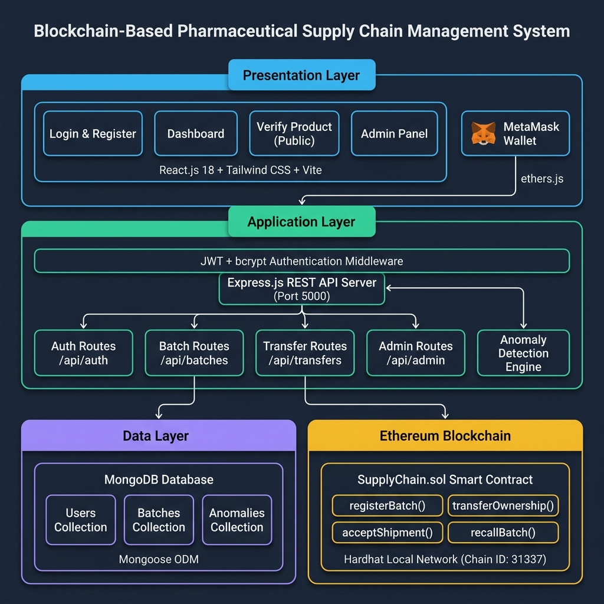

# Blockchain-Based Pharmaceutical Supply Chain Management System

**with QR Verification and Anomaly Detection**
1
---

| Field | Details |
|---|---|
| **Project Title** | Blockchain-Based Pharmaceutical Supply Chain Management System |
| **Domain** | Blockchain, Supply Chain, Healthcare |
| **Tech Stack** | React.js, Node.js, Solidity, MongoDB, MetaMask |
| **Blockchain** | Ethereum (Hardhat Local Network) |

---

## Table of Contents

1. [Introduction](#1-introduction)
2. [Objectives](#2-objectives)
3. [System Architecture](#3-system-architecture)
4. [Technology Stack](#4-technology-stack)
5. [Smart Contract](#5-smart-contract)
6. [Database Design](#6-database-design)
7. [API Endpoints](#7-api-endpoints)
8. [Modules & Features](#8-modules--features)
9. [Setup & Deployment](#9-setup--deployment)
10. [Testing & Screenshots](#10-testing--screenshots)
11. [Conclusion](#11-conclusion)

---

## 1. Introduction

Counterfeit medicines are a serious global health threat. The WHO estimates that **10% of medicines** in developing countries are fake, causing around **1 million deaths per year**.

This project uses **Ethereum blockchain** to build a tamper-proof pharmaceutical tracking system. Every medicine batch is tracked from the Manufacturer → Distributor → Pharmacy → Consumer. Consumers can scan a **QR code** on the medicine packaging to verify its authenticity.

The system also includes an **Anomaly Detection Engine** that automatically flags suspicious activities like skipped supply chain stages, unauthorized transfers, and expired product movements.

---

## 2. Objectives

1. Record every supply chain event on the blockchain for tamper-proof tracking
2. Provide role-based dashboards for Manufacturer, Distributor, Pharmacy, and Admin
3. Enable consumers to verify medicine authenticity via QR code scanning
4. Automatically detect counterfeit indicators using anomaly detection algorithms
5. Give administrators tools for user approval, analytics, and anomaly monitoring

---

## 3. System Architecture

### 3.1 Architecture Diagram



The system uses a **three-tier architecture**:

| Layer | Technology | Purpose |
|---|---|---|
| Frontend | React.js + Tailwind CSS + Vite | User interface (port 5173) |
| Backend | Express.js + Node.js | REST API server (port 5000) |
| Database | MongoDB + Mongoose | Off-chain data storage (port 27017) |
| Blockchain | Solidity + Hardhat + ethers.js | On-chain immutable records (port 8545) |
| Wallet | MetaMask | Transaction signing |

### 3.2 Supply Chain Workflow


**Flow:** Manufacturer → Distributor → Pharmacy → Consumer

Each transfer is recorded both on the Ethereum blockchain (via smart contract) and in MongoDB (via REST API). The consumer can verify the full journey by scanning a QR code.

---

## 4. Technology Stack

### Frontend
- React.js 18, Vite, Tailwind CSS, React Router, Axios
- ethers.js (blockchain), Chart.js (analytics)
- qrcode (generation), html5-qrcode (scanning), lucide-react (icons)

### Backend
- Node.js, Express.js, Mongoose, bcryptjs, jsonwebtoken
- cors, dotenv, nodemailer, cloudinary

### Blockchain
- Solidity 0.8.24, Hardhat, @openzeppelin/contracts

### Tools
- MetaMask, MongoDB, Postman, VS Code, Git

---

## 5. Smart Contract

**File:** `blockchain/contracts/SupplyChain.sol`

### Key Functions

| Function | Access | Description |
|---|---|---|
| `registerBatch()` | Public | Register a new drug batch on-chain |
| `transferOwnership()` | Owner Only | Transfer batch to another entity |
| `acceptShipment()` | Owner Only | Confirm receipt of a batch |
| `recallBatch()` | Manufacturer Only | Recall a defective batch |
| `getBatch()` | Public View | Get batch details |
| `getBatchHistory()` | Public View | Get chain of custody |

### Events Emitted
- `BatchRegistered` — When a new batch is created
- `TransferInitiated` — When ownership is transferred
- `ShipmentAccepted` — When a recipient confirms delivery
- `BatchRecalled` — When a batch is recalled

### Security Modifiers
- `onlyCurrentOwner` — Only the current batch owner can transfer
- `onlyManufacturer` — Only the original manufacturer can recall

---

## 6. Database Design

### Users Collection
Stores name, email, hashed password, role (Manufacturer/Distributor/Pharmacy/Admin), company name, license number, Ethereum address, and approval status.

### Batches Collection
Stores batch ID, drug name, product code, manufacturer, current owner, quantity, dates, status, transaction hash, risk score, scan count, and a history array of all transfer events.

### Anomalies Collection
Stores batch ID, anomaly type, severity (Low/Medium/High/Critical), description, and resolution status.

---

## 7. API Endpoints

### Authentication
| Method | Endpoint | Description |
|---|---|---|
| POST | `/api/auth/register` | Register new user |
| POST | `/api/auth/login` | Login and get JWT token |
| GET | `/api/auth/me` | Get current profile |
| GET | `/api/auth/partners` | List approved partners |

### Batches
| Method | Endpoint | Description |
|---|---|---|
| POST | `/api/batches` | Create new batch (Manufacturer only) |
| GET | `/api/batches` | List all batches |
| GET | `/api/batches/:id` | Get batch details |
| POST | `/api/batches/:id/verify` | **Public** — Verify product |
| POST | `/api/batches/:id/report` | **Public** — Report suspicious product |

### Transfers
| Method | Endpoint | Description |
|---|---|---|
| POST | `/api/transfers/initiate` | Initiate ownership transfer |
| POST | `/api/transfers/accept` | Accept shipment |
| POST | `/api/transfers/recall` | Recall batch |

### Admin
| Method | Endpoint | Description |
|---|---|---|
| GET | `/api/admin/users` | List all users |
| PUT | `/api/admin/users/:id/approve` | Approve a user |
| GET | `/api/admin/anomalies` | List anomalies |
| GET | `/api/admin/stats` | System statistics |

---

## 8. Modules & Features

### Module 1: User Management & Authentication
- Registration with role selection and company details
- JWT-based login with bcrypt password hashing
- Role-based access control middleware
- Admin approval workflow for new organizations
- Pre-seeded test accounts for development

### Module 2: Drug Batch Management
- Batch registration with blockchain transaction recording
- QR code generation for each batch
- Status lifecycle: Manufactured → In Transit → Received → Recalled
- Search by batch ID or drug name

### Module 3: Supply Chain Tracking
- Manufacturer → Distributor → Pharmacy transfers
- On-chain ownership validation via smart contract
- Shipment acceptance confirmation
- Complete chain of custody logging

### Module 4: QR Verification System
- QR code generation and download
- Camera-based QR scanning
- Public verification portal (no login needed)
- Authenticity classification: Genuine / Suspicious / Expired / Invalid

### Module 5: Anomaly Detection Engine
Four automated detection rules:

| Rule | Condition | Risk Score |
|---|---|---|
| Expired Product | Active batch past expiry date | +40 |
| Missing Stage | Skipped Distributor in chain | +50 |
| Unauthorized Transfer | Pharmacy initiated a transfer | +45 |
| Duplicate QR Scans | More than 50 scans | +30 |

Risk classification: 0-30 = Genuine, 31-69 = Suspicious, 70-100 = Critical Alert

### Module 6: Admin Dashboard
- User listing and approval management
- System statistics and batch analytics
- Anomaly monitoring and resolution

---

## 9. Setup & Deployment

### Prerequisites
- Node.js v18+, MongoDB, MetaMask browser extension

### Steps

**1. Start Blockchain:**
```bash
cd blockchain && npm install && npx hardhat node
```

**2. Deploy Smart Contract:**
```bash
cd blockchain && npx hardhat run scripts/deploy.js --network localhost
```

**3. Start Backend:**
```bash
cd backend && npm install && npm run dev
```

**4. Start Frontend:**
```bash
cd frontend && npm install && npm run dev
```

**5. Configure MetaMask:**
- Add network: Hardhat Local (RPC: `http://127.0.0.1:8545`, Chain ID: `31337`)
- Import test accounts using private keys below

### Test Accounts

| Role | Email | Password | ETH Address |
|---|---|---|---|
| Manufacturer | manufacturer@pharma.com | manufacturer123 | `0xf39Fd6e51aad88F6F4ce6aB8827279cffFb92266` |
| Distributor | distributor@pharma.com | distributor123 | `0x70997970C51812dc3A010C7d01b50e0d17dc79C8` |
| Pharmacy | pharmacy@pharma.com | pharmacy123 | `0x3C44CdDdB6a900fa2b585dd299e03d12FA4293BC` |
| Admin | admin@pharma.com | admin123 | `0x90F79bf6EB2c4f870365E785982E1f101E93b906` |

---

## 10. Testing & Screenshots

The complete system was tested end-to-end. Below are screenshots of each stage.

### 10.1 Environment Setup

**Starting Hardhat Local Blockchain Node:**


**Test Accounts with 10,000 ETH each:**


**Smart Contract Compiled and Deployed:**


**MongoDB Database Running:**


**Express Backend API Server Running:**


**React Vite Frontend Running:**


---

### 10.2 MetaMask Configuration

**Four Hardhat Accounts Imported into MetaMask:**


**Manufacturer Wallet Connected:**


---

### 10.3 Manufacturer Workflow

**Login as Manufacturer:**


**New Drug Batch Created on Blockchain:**


**MetaMask Transaction Confirmation:**


**Batch Appears in Dashboard:**


**Batch Dispatched to Distributor:**


**Dashboard Showing Dispatched Inventory:**


---

### 10.4 Distributor Workflow

**Incoming Batch Received from Manufacturer:**


**Distributor Accepts the Shipment:**


**Distributor Dispatches Batch to Pharmacy:**


**Batch In Transit to Pharmacy:**


---

### 10.5 Pharmacy Workflow

**Pharmacy Confirms Receipt of Shipment:**


---

### 10.6 Consumer Verification

**Product Verification via Public Portal:**


---

## 11. Conclusion

This project successfully demonstrates how blockchain technology can secure the pharmaceutical supply chain. Key achievements:

1. **Immutable Tracking** — Every batch event is recorded on the Ethereum blockchain
2. **Consumer Verification** — QR-based public portal for instant authenticity checks
3. **Automated Detection** — Anomaly engine flags expired products, skipped stages, and unauthorized transfers
4. **Multi-Role Platform** — Dedicated interfaces for Manufacturer, Distributor, Pharmacy, and Admin
5. **Dual-Layer Storage** — On-chain immutability (Ethereum) + off-chain flexibility (MongoDB)

The system validates that blockchain can enhance trust, transparency, and traceability in pharmaceutical supply chains, protecting consumers from counterfeit medicines.

---

## Project Structure

```
Block Chain Project/
├── blockchain/
│   ├── contracts/SupplyChain.sol        # Smart contract
│   ├── scripts/deploy.js               # Deployment script
│   └── hardhat.config.js               # Hardhat config
├── backend/
│   ├── src/
│   │   ├── config/db.js                # MongoDB connection
│   │   ├── middleware/auth.js           # JWT + RBAC middleware
│   │   ├── models/                      # User, Batch, Anomaly schemas
│   │   ├── routes/                      # auth, batches, transfers, admin
│   │   ├── utils/anomalyDetector.js     # Detection engine
│   │   └── index.js                     # Express entry point
│   └── package.json
├── frontend/
│   ├── src/
│   │   ├── components/                  # Navbar, Sidebar, ProtectedRoute
│   │   ├── context/                     # AuthContext, Web3Context
│   │   ├── pages/                       # All 7 pages
│   │   └── App.jsx                      # Router setup
│   └── package.json
└── Images/                              # Screenshots & diagrams
```

---

*Report Generated: June 2026*
